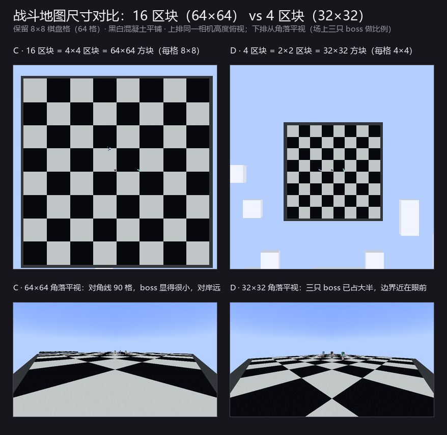

# 战斗地图尺寸对比：16 区块（64×64） vs 4 区块（32×32）

保留**国际象棋 8×8 棋盘格**（64 格），把「格子」从区块级缩小后重做两版战斗地图，实机截图对比。
（上一版 8×8 区块 = 128×128 方块太大，已废弃。）

## 两版规格

| | C · 16 区块版 | D · 4 区块版 |
|---|---|---|
| 占地 | **64×64 方块**（4×4 区块 = 16 区块） | **32×32 方块**（2×2 区块 = 4 区块） |
| 棋格 | 8×8 格，每格 **8×8 方块** | 8×8 格，每格 **4×4 方块** |
| 面积 | 4,096 方块² | 1,024 方块² |
| 中心到角落 | 45.3 格 | 22.6 格 |
| 对角两端距离 | 90.5 格 | 45.3 格 |

方块：`white_concrete` / `black_concrete`（纯色平铺，8×8 棋盘格保留），外圈 `gray_concrete` 1 格包边。
坐标（开发世界 `run/world`，y=250 悬浮）：C 在 `x400..463, z0..63`；D 在 `x500..531, z0..31`。



## 结论：**16 区块（64×64）更适合当三 boss 战斗地图**

| 判据 | 16 区块版 64×64 | 4 区块版 32×32 |
|---|---|---|
| 与 `PARTICIPANT_RADIUS = 48` 的关系 | 中心到角落 45.3 < 48，**全场都算参战** | 22.6 < 48，同样安全（但空间浪费在防守半径上） |
| 三 boss 站位 + 观感 | 三只 boss 站中线，场地仍显空，有跑位空间 | 三只 boss 已占掉大半个场地，边界近在眼前，**拥挤** |
| 躲判决环（半径 10） | 覆盖面积 **7.7%**，有充足走位 | 覆盖 **30.7%**，一次判决几乎覆盖半场 |
| 躲判决铃冲击波（半径 8） | 覆盖 4.9% | 覆盖 19.6% |
| 召唤物容量（桐香最多 6 护卫 + 郁子最多 4 山羊 + 3 boss + 4 玩家） | 放得下，不挡走位 | 全挤在一起，近战/冲刺互相卡位 |
| 冲刺/瞬移类技能（礼 >20 格强制瞬移、郁子冲刺、桐香铁拳前压） | 有加速/位移空间 | 几步就撞边，技能表现被压缩 |
| 玩家视野 | 对岸 64 格外，boss 小但可辨 | 全场一眼看完，观感更"擂台" |

**为什么 128×128（8×8 区块）不行**：两角对角 181 格，远超 `PARTICIPANT_RADIUS = 48` 和桐香/郁子的
`FOLLOW_RANGE = 48`——玩家跑到边缘就不算参战、boss 也会脱战，三 boss 会分散在地图各处各自为战，
战斗节奏散掉。16 区块版是「全图在参与半径内」的上限附近，所以最合适。

**如果最终必须用 4 区块（32×32）**：把桐香的「全校裁决」半径 10、判决铃半径 8 各下调约 30%
（例如 10→7、8→6），否则单次 AoE 占场过大，玩家几乎无处可躲。

## 实机截图

- `shots/C_16chunks_top.png` / `D_4chunks_top.png`：同一相机高度俯视（真实尺寸比 2:1）
- `shots/C_16chunks_eye.png` / `D_4chunks_eye.png`：角落平视，场上放了桐香/礼/郁子三只 boss 做比例
- `shots/C_16chunks_detail.png` / `D_4chunks_detail.png`：近距离俯视细节

## 复现

函数已备份：`arena_c.mcfunction`（64×64）、`arena_d.mcfunction`（32×32）、`arena_clean.mcfunction`（清理）。
放回存档 datapacks 后：

```mcfunction
/reload
/function galboss:arena_clean
/function galboss:arena_c
/function galboss:arena_d
```

> 注意：函数里的 `/fill` 只能在**已加载区块**内生效，执行前先把玩家/相机传送到场地附近。

## 限制

- 实机在 dev 世界悬空搭建（y=250），没有墙体/屋顶/光照氛围；真实地图还需要围墙、入口、观战位。
- 只对比了尺寸，没有实跑完整三 boss 战斗（需要玩家真实参战、AI 全开）。
- 棋盘格颜色用混凝土纯色；如果走"石砖/木地板"风格，观感会不同但不影响尺寸结论。
