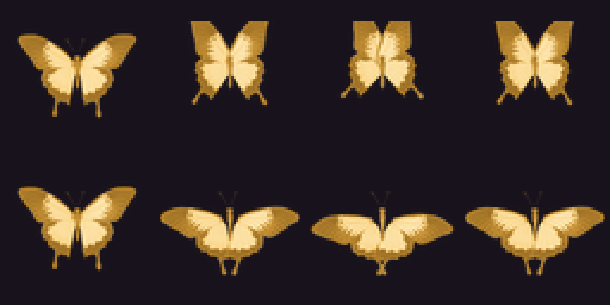

# 金色镂空蝴蝶粒子（方案与实现）

贝阿朵莉切身边的**金色发光蝴蝶**粒子。素材来自用户提供的 After Effects 工程
（`D:\BaiduNetdiskDownload\蝴蝶.7z`，其中三层 PNG 已归档在 `tools/particle/src/`），
按参考图的效果做成：**写实蝶轮廓 + 金色化 + 镂空 + 发光描边 + 扇翅动画**。



## 一、MC 里做「发光蝴蝶粒子」的几条路

| 方案 | 做法 | 优点 | 缺点 |
|---|---|---|---|
| **A. 自定义粒子（✅ 采用）** | 注册 `ParticleType` + `ParticleProvider`；自己写 `Particle` 子类：自选贴图、自排帧、自控运动与光照 | 性能好（每只 1 个 quad）、完全可控（镂空/发光/动画/飘动）、纯客户端、无需实体与网络 | 要手写渲染状态与帧 UV |
| B. 只当「序列帧特效」复用 pixelfx 通道 | 烘成 slug，用 `PixelfxFx.playLooping` 播 | 零新渲染代码 | 现有 FX 是**静态锚点**：蝴蝶不会飘、不会各自扇翅，像贴纸 |
| C. GeckoLib 实体（真 3D 蝴蝶） | 实体 + 骨骼扇翅 | 3D 深度、可停在肩上 | 每只都是实体：网络同步/AI/性能都贵，只适合 1~3 只主角蝶 |
| D. 原版粒子（火焰/发光点拼） | `ParticleTypes.*` 拼 | 最简单 | 做不出「镂空蝴蝶」的形状与扇翅 |

**结论：环境蝶群用 A（几十~几百只都行），需要特写主角蝶时再补 C。**

## 二、素材管线（`make_golden_butterfly_ref.py`）

AE 工程里蝴蝶是三层：**身体中轴 / 左翼 / 右翼**（白底 PNG）。脚本按这四步烘：

1. **抠白底** → 透明（亮度阈值 + 边缘渐隐，避免白边）。
2. **金色化** → 按原像素亮度映射到金色 ramp；暗部也抬到深金（不压到近黑），
   否则夜里原来的黑边会变成突兀的「黑框」。
3. **扇翅** → 以翼根（身体中轴 x≈274, y≈211）为轴，把左/右翼分别旋转 ±34°，
   三角波循环，合成 **8 帧**。
4. **辉光图** → 只留最亮的一小撮（内核）+ 轮廓外扩一圈的光边（bloom）。

输出：
- `assets/galboss/textures/particle/golden_butterfly.png`（256×128，8 帧，4×2，帧 64×64）
- `assets/galboss/textures/particle/golden_butterfly_glow.png`（同布局，加色趟用）
- `_preview/`：深底放大预览（人工检查镂空/扇翅/辉光）

重跑（只用仓库里的源 PNG，无需 AE）：

```powershell
python tools/particle/make_golden_butterfly_ref.py
```

## 三、渲染：为什么要两层

单靠一张贴图做不出参考图那种「发光轮廓」：

- **本体层**（`ButterflyParticle`）：普通 **alpha 混合**，保留锐利轮廓与镂空孔
  （贴图 alpha=0 的地方透出场景）。
- **辉光层**（`ButterflyGlowParticle`）：**加色混合**（`SRC_ALPHA, ONE`），
  亮部会「烧」出光晕、轮廓会发亮，透明镂空处 alpha=0 完全不贡献颜色 → 镂空依然透出背景。

原版粒子一次 render 只能用一个 RenderType，所以拆成两只粒子；**本体粒子在第一次 tick 时
自动在同位置、同相位挂上辉光层**（放 tick 而不是 createParticle，是为了不在粒子引擎的渲染迭代中改它的列表），
两层逐帧严格对齐。调用方（贝阿朵莉切的环境蝶群、`/galboss butterfly`）只需要发本体粒子。

其它关键点：

- **贴图不过粒子图集**：自定义 `ParticleRenderType.begin()` 里直接 `setShaderTexture(0, 自己的RL)`，
  并 `setFilter(false, false)`（最近邻、关 mipmap），像素画不会被插值糊掉。
  注册用 Forge 的 `registerSpecial`（非 JSON 粒子，**不能**再放同名 `particles/*.json`）。
- **自发光**：`getLightColor()` 固定返回 `LightTexture.FULL_BRIGHT` → 夜里也是亮的。
- **逐只不同步**：每颗粒子随机相位 `(age / frameTicks + phaseOffset) % frames` 取帧
  （橙蝶 2 帧 × 3 tick → 0.3s 一循环；帧数与帧长都在 `ButterflySprite` 里）。
- **UV 内缩半纹素**，避免最近邻采样到相邻帧。
- **运动像蝴蝶**：不用原版重力/摩擦，正弦漂移 + 随机盘旋方向 + 阻尼限速，绕出生点小幅游荡；
  寿命 4~10s，淡入淡出。

## 四、接进游戏

- `particle/ModParticles`：`galboss:golden_butterfly`（本体）+ `galboss:golden_butterfly_glow`（辉光）。
  **ID 里的 golden 是历史命名**：现在画的是 ER 橙蝶，但 ID 是服务端发粒子包的线格式
  （贝阿朵莉切环境蝶群、蝴蝶弹实体、`/galboss butterfly` 都在引用），换美术不动 ID。
- `client/particle/`：`AbstractButterflyParticle`（共用运动/帧/UV 逻辑）、
  `ButterflyParticle`（本体）+ `ButterflyGlowParticle`（辉光）、
  `ButterflySprite`（图集布局 record）、`Butterflies`（可选的几套精灵表）。
  2026-11-17 之前这三个类叫 `*GoldenButterflyParticle`，因为素材从金色镂空蝶换成了橙蝶而改名。
- `client/ClientSetup#registerParticleProviders`：注册两个 provider。
- **贝阿朵莉切环境蝶群**：`BeatriceEntity#aiStep` 客户端分支按概率生成（平时 1/14 每 tick、
  碑文进行中 1/5），半径 1~3.2 格。纯客户端，不走网络、不占实体。
- **调试/验收命令**：`/galboss butterfly [count]`（默认 24，上限 200）；单只定点测：
  `/execute as <player> at <player> run particle galboss:golden_butterfly ^ ^1.55 ^1.8 0.02 0.02 0.02 0 1`
  （注意 caret 坐标以**脚下**为原点，不抬 1.55 会生成在膝盖以下的视角外）。

## 四之二、当前素材：ER 橙蝶（2 帧拍翅）

| 项 | 值 |
|---|---|
| 来源 | `file:///D:/game/mc/er-particle-preview.html` 内嵌贴图表里的 `butterfly_orange_flap`（`idx=0/1`） |
| 原图 | 32×32 × 2 帧，4 色调色板：橙底 `rgb(244,146,52)` / 暗橙 `rgb(150,72,28)` / 深褐轮廓 `rgb(84,44,22)` / 亮黄高光 `rgb(255,226,120)` |
| 帧内容 | `idx=0` 双翅展开（bbox 30×18）/ `idx=1` 双翅收拢（bbox 18×20） |
| 落库源帧 | `tools/particle/src/er_butterfly_orange_flap_{0,1}.png`（vendor 进来，不依赖那个 html） |
| 生成器 | `python tools/particle/import_er_butterfly.py`（`--from-html <path>` 可直接从预览表重新抽帧） |
| 图集 | `textures/particle/butterfly_orange.png` 64×32（2 列 × 1 行 × 32px）；`..._glow.png` 同布局 |
| 帧长 | `Butterflies.ORANGE_BODY` 的 `frameTicks = 3` → 2 帧一循环 0.3s（拍翅感比 8 帧金蝶快） |

发光层是**从本体按色相推出来的**，不是 ER 原作里的：亮黄高光提纯成暖白、其余压成橙色光，
再把轮廓 dilate + 高斯模糊出一圈柔光（`HALO_ALPHA=70`、`HALO_BLUR=1.6`）。
⚠ 两个坑：① 这只蝴蝶几乎顶到画框边（bbox x 1..31），光晕不按到边距衰减的话，在图集帧边界
会被硬切，加色混合下出现一圈方形"鬼影" —— 脚本里用 `edge / 3` 的衰减解决了；
② 辉光帧长必须和本体一致，否则两层错帧、光斑糊在别处。

想换回金色镂空蝶（4×2 / 64px / 8 帧，`make_golden_butterfly_ref.py` 那套）：把
`ButterflyParticle.SPRITE` / `ButterflyGlowParticle.SPRITE` 换成 `Butterflies.GOLD_BODY` /
`GOLD_GLOW` 即可，图集布局跟着 sprite 走，不用改常量。

实机证据：`_preview/butterfly_orange_flap_ingame.png`（8 帧连拍，能看到展开/收拢交替）、
`_preview/butterfly_orange_ingame_open.png`、`..._fold.png`。

## 五、实测（MC 1.20.1 / Forge 47.4.10 / dev 客户端 854×480）

| 项 | 结果 |
|---|---|
| 贴图 | 现用橙蝶：本体 0.5KB + 辉光 1.3KB（各 64×32 / 2 帧）；金蝶旧版 22KB + 17KB（256×128 / 8 帧） |
| 单只开销 | 1 quad × 2 层（本体 alpha + 辉光加色） |
| 200 只同屏 | 帧率无明显下降 |
| 夜间观感 | 橙蝶 + 暖色发光轮廓、扇翅清晰（2026-11-17 换成 ER 橙蝶后实测） |
| 日志 | 无缺贴图/异常 |

## 六、调参速查

| 参数 | 位置 | 效果 |
|---|---|---|
| `frameTicks` | `Butterflies.ORANGE_BODY`（现用 3） | 扇翅速度（2 帧 × 3 tick = 0.3s 一循环） |
| 图集布局 | `ButterflySprite`（cols/rows/framePixels） | 换素材只需换 sprite，不用改常量 |
| `quadSize` | `AbstractButterflyParticle` 构造（0.22~0.45 格） | 蝴蝶大小 |
| 螺旋半径 / 角速度 / 前进速度 | 同上 `orbitRadius` / `orbitSpeed` / `forwardSpeed` | 每只蝶的"绕圈 + 前进"（0.10~0.20 格 / 0.30~0.45 rad/tick / 0.020~0.035 格/tick） |
| 尾迹螺线 | `ButterflyMissileEntity` 的 `HELIX_STEP` / `HELIX_RADIUS` | 每只尾迹蝶绕飞行轴偏 0.9 rad、半径 0.3 格 |
| `lifetime` | 同上（80~200 tick） | 存活时长 |
| 辉光倍率 / 亮度 | `ButterflyGlowParticle`（1.22 倍 / alpha 0.5） | 光晕强度 |
| 生成密度 | `BeatriceEntity#spawnGoldenButterfliesClient` 的 `chance` | 平时 1/14、碑文中 1/5 |
| 发光层色板/光晕 | `import_er_butterfly.py` 的 `GLOW_*` / `HALO_*` | 换色/换光晕重跑 |
| 金色 ramp（旧素材） | `make_golden_butterfly_ref.py` 的 `GOLD_RAMP` | 换金/换色重跑 |
| 扇翅幅度（旧素材） | 同上 `up = -34.0 * wave` | 翅膀张开角度 |

后续可做：给辉光再加一层飞散光点（参考图身后那种拖尾）、把颜色 ramp 改成紫/血红做不同 boss 的变体、
主角蝶用 GeckoLib 实体做 3D 特写。
